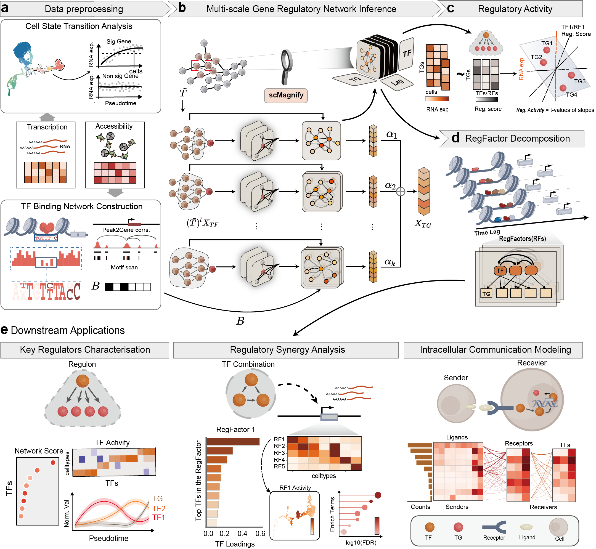

# scMagnify: **M**ulti sc**A**le **G**ene regulatory **N**etwork **I**n**F**erence and anal**Y**sis

[![Tests][badge-tests]][tests]
[![Documentation][badge-docs]][documentation]
[![PyPI][badge-pypi]][pypi]
[![License][badge-license]][license]

[badge-tests]: https://img.shields.io/github/actions/workflow/status/LiHongCSBLab/scMagnify/test.yaml?branch=main
[badge-docs]: https://img.shields.io/readthedocs/scmagnify
[badge-pypi]: https://img.shields.io/pypi/v/scmagnify
[badge-license]: https://img.shields.io/github/license/LiHongCSBLab/scMagnify

scMagnify is a computational framework to infer GRNs and explore dynamic regulation synergy from single-cell multiome data.



## 🔑scMagnify’s key applications

1. Infer `multi-scale dynamic GRNs` via nonlinear Granger causality, enabling the identification of key regulators and quantification of their regulation lags.
2. Decompose GRNs into combinatorial regulatory modules (`RegFactors`) via tensor decomposition.
3. Estimate `regulatory activity` for TFs and RegFactors via [decoupler](https://github.com/scverse/decoupler).
4. Map signaling-to-transcription cascades linking microenvironment cues to `intracellular regulation`.

## 🚀Getting started

Please refer to the [documentation][],
in particular, the [API documentation][].

## 📦Installation

You need to have Python 3.10 or newer installed on your system.
If you don't have Python installed, we recommend installing [uv](https://github.com/astral-sh/uv).

There are several alternative options to install scMagnify:


1. Install the latest release of `scMagnify` from [PyPI][]:

```bash
uv pip install scmagnify
```
2. Install the latest stable version from conda-forge using mamba or conda

```bash
mamba create -n=scm conda-forge::scmagnify
```
3. Install the latest development version:

```bash
uv pip install git+https://github.com/LiHongCSBLab/scMagnify.git@main
```

## 🏷️Release notes

See the [changelog][].

## 📬Contact

For questions and help requests, you can reach out in the [scverse discourse][].
If you found a bug, please use the [issue tracker][].

## 📓Citation

If you use `scMagnify` in your work, please cite:

> Chen, X., Yan, X., Shen, B., Wang, H., Tang, Z., Zang, Y., Lin, P., Zhang, H., Li, Y., & Li, H. (2026). Decomposing multi-scale dynamic regulation from single-cell multiomics with scMagnify. *Nature Communications*, 17. https://doi.org/10.1038/s41467-026-78441-9

```bibtex
@article{Chen_2026,
  title = {Decomposing multi-scale dynamic regulation from single-cell multiomics with scMagnify},
  author = {Chen, Xufeng and Yan, Xi and Shen, Bihan and Wang, Heqi and Tang, Zhixuan and Zang, Yan and Lin, Ping and Zhang, Haibing and Li, Yu and Li, Hong},
  journal = {Nature Communications},
  volume = {17},
  year = {2026},
  month = oct,
  doi = {10.1038/s41467-026-78441-9},
  url = {https://www.nature.com/articles/s41467-026-78441-9}
}
```

[mambaforge]: https://github.com/conda-forge/miniforge#mambaforge
[scverse discourse]: https://discourse.scverse.org/
[issue tracker]: https://github.com/LiHongCSBLab/scMagnify/issues
[tests]: https://github.com/LiHongCSBLab/scMagnify/actions/workflows/test.yaml
[documentation]: https://scmagnify.readthedocs.io
[changelog]: https://scmagnify.readthedocs.io/en/latest/changelog.html
[api documentation]: https://scmagnify.readthedocs.io/en/latest/api/index.html
[pypi]: https://pypi.org/project/scmagnify/
[license]: https://github.com/LiHongCSBLab/scMagnify/blob/main/LICENSE
